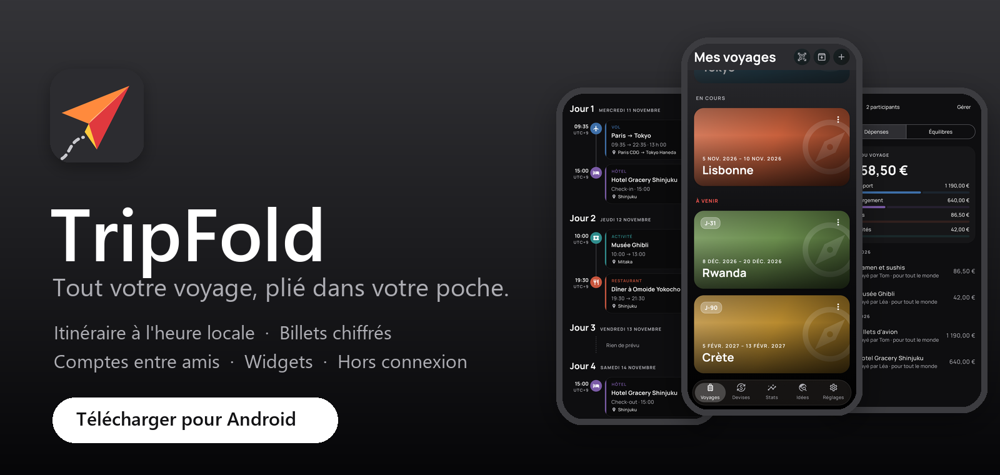
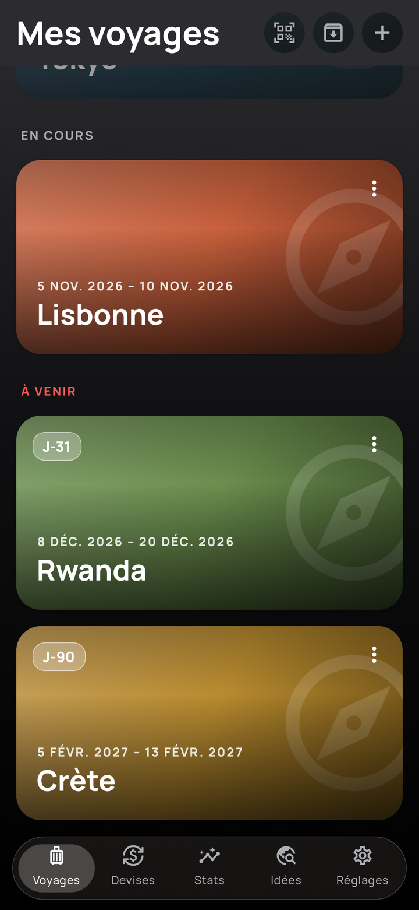
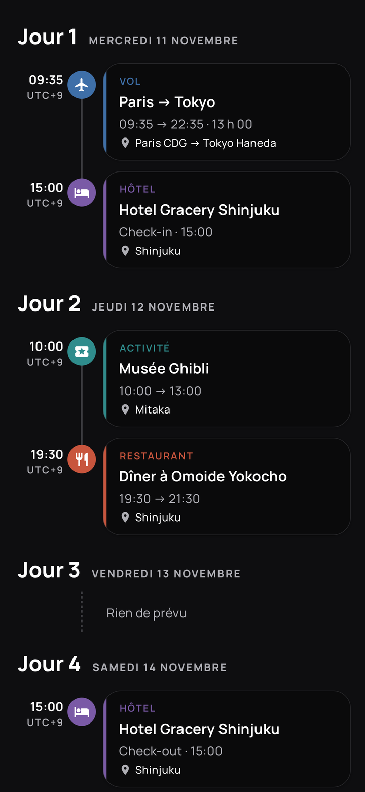
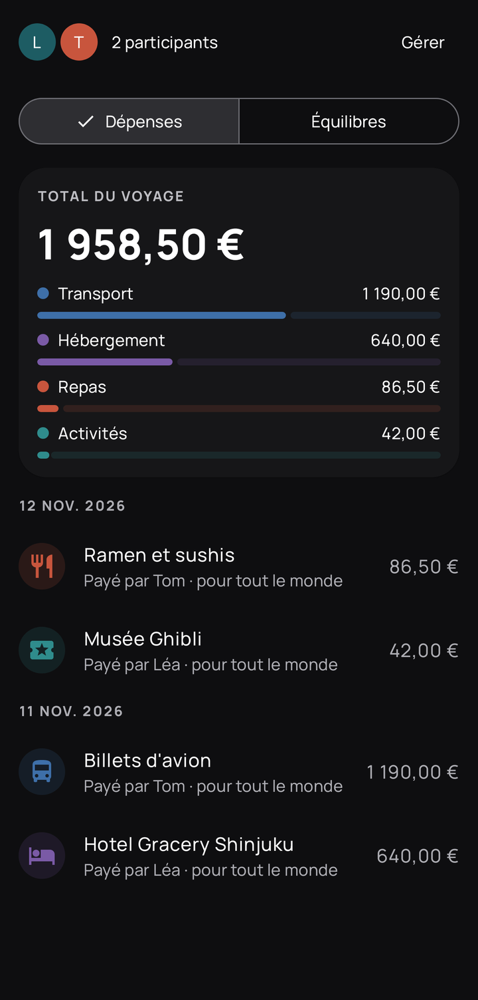
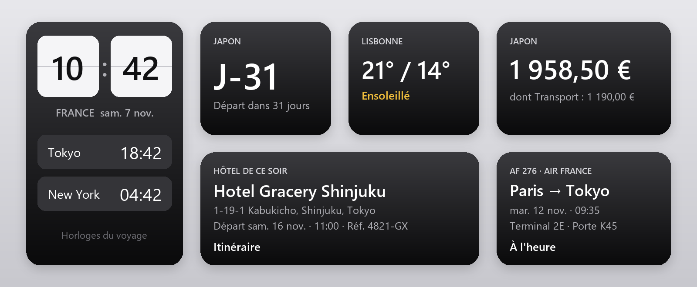

  

  
  

  <b>Gratuit</b> · <b>Sans publicité</b> · <b>Fonctionne hors connexion</b> · <b>Android 8 et plus</b> · <b>Français et anglais</b>

---

## ✈️ Tout votre voyage, au même endroit

Vols, hôtels, trains, billets, factures, dépenses, météo, carte… **TripFold** range tout votre voyage dans un seul carnet,
toujours dans votre poche, **même sans réseau** une fois sur place.

  
  &nbsp;
  
  &nbsp;
  

<table>
<tr>
<td width="50%" valign="top">

### 🗓️ Un itinéraire limpide
Jour par jour, avec **l'heure locale de chaque lieu** : un vol Lyon → Tokyo affiche le départ à l'heure de Lyon et
l'arrivée à l'heure de Tokyo, durée réelle comprise. Un élément saisi dans le mauvais fuseau ? TripFold le signale et le
corrige en un geste.

</td>
<td width="50%" valign="top">

### 📎 Vos billets toujours sous la main
Billets, réservations, passeports **chiffrés sur le téléphone**, joints à chaque étape. Un appui pour ouvrir, un geste
pour **zoomer** sur un QR code à l'embarquement.

</td>
</tr>
<tr>
<td valign="top">

### 🪄 Remplissage automatique
Une photo de facture, une capture ou un PDF de réservation : TripFold **remplit les champs tout seul** (dates, lieux,
référence, prix). Vous vérifiez, c'est enregistré.

</td>
<td valign="top">

### 💶 Les comptes entre amis, sans prise de tête
Dépenses dans toutes les devises, converties au cours du jour, qui a payé quoi, et **remboursements suggérés** en un
minimum de virements.

</td>
</tr>
<tr>
<td valign="top">

### 👨‍👩‍👧 Préparez le voyage à plusieurs
Un lien ou un QR code, et vos compagnons voient et complètent le même itinéraire, avec une notification à chaque
nouvelle réservation. Documents chiffrés **de bout en bout**.

</td>
<td valign="top">

### 📱 Sur tous vos appareils
**Nouveau** : retrouvez vos voyages, documents et réglages sur votre téléphone **et** votre tablette. On relie un
appareil en **scannant un QR code**, sans mot de passe à retenir.

</td>
</tr>
</table>

## 🧩 Des widgets pour voyager l'esprit léger

**Onze widgets** pour l'écran d'accueil, en noir, gris et blanc, qui suivent le mode clair ou sombre du téléphone.

  

**Horloges du voyage** (l'heure de chez vous en grand, puis vos deux prochaines destinations) · **Compte à rebours** ·
**Mon vol** (porte, terminal, retard) · **Mon hôtel** (adresse, référence, itinéraire en un appui) · **Budget du voyage** ·
**Aujourd'hui** (le programme du jour) · **Prochain rappel** · **Décalage horaire** · **Météo** · **Convertisseur** ·
**Prochain voyage**.

Votre **pays de résidence** (Réglages › Profil) reste l'heure de référence, même quand le téléphone est passé à l'heure
du pays visité.

## 🌍 Et pour rêver au prochain départ

- **Votre globe** à faire tourner, pays visités coloriés, kilomètres parcourus et heures de vol.
- **Des idées de destinations pas chères**, avec un budget indicatif par jour et les prix du moment des vols et hôtels.
- **Rappels** la veille d'un vol, **météo** des destinations, **carte** de l'itinéraire, **convertisseur** de devises.
- **Sauvegarde** de tous vos voyages dans un fichier, thème clair ou sombre, interface sobre en noir et blanc.

## 📲 Installer en 1 minute

1. Sur votre téléphone Android, touchez **[Télécharger TripFold.apk](https://github.com/Jonathanmx5/voyago-app/releases/latest/download/TripFold.apk)**.
2. Ouvrez le fichier téléchargé. Android demande d'autoriser le navigateur à installer des applications : acceptez.
3. Ouvrez **TripFold** et connectez-vous avec votre compte Google. C'est prêt.

> TripFold n'est pas encore sur le Play Store. Les **mises à jour** se font depuis l'application : un point rouge
> apparaît sur **Réglages** quand une nouvelle version sort, puis **Réglages › Mises à jour › Mettre à jour**.
> Vos voyages sont conservés.

## 🔒 Vos voyages restent à vous

- **Aucune publicité**, aucun outil de mesure d'audience.
- Vos voyages restent sur votre téléphone ; seuls ceux que vous partagez ou synchronisez quittent l'appareil.
- Documents **chiffrés** sur l'appareil, et **de bout en bout** dans les voyages partagés et la synchronisation.
- La lecture automatique d'un document l'envoie à Google (Gemini) : TripFold vous le demande avant le premier envoi.
- [Politique de confidentialité complète](https://voyago-b9c03.web.app/confidentialite).

---

   
  TripFold (anciennement Voyago). Ce dépôt contient les versions à installer ; le code source est privé. 
  Les captures montrent des voyages fictifs de démonstration.

